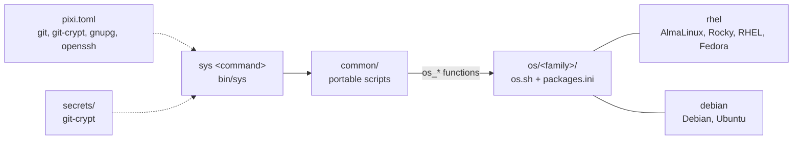

# adminSys v0.1.0

*Created: 2026-11-27*

What you need to administer a Linux-like server, with one rule: **what depends on the
system lives in `os/`, and nothing else is allowed to know which distribution it runs on.**
Everything else is portable.



## 1. Use it

```bash
git clone https://github.com/<you>/adminSys.git && cd adminSys
bin/sys detect                       # which os/ layer applies to this machine
sudo bin/sys base                    # base tooling, firewall, fail2ban, automatic security updates
sudo bin/sys base --with build       # + gcc, gfortran, flex, bison, make
sudo bin/sys update --all            # the equivalent of apt update && apt upgrade, on any family
bin/sys ssh-agent                    # one ssh-agent per user (passphrase asked once)
sudo bin/sys ssh-harden              # key-only SSH, no root login (once every user has a key)
bin/sys crypt-init                   # git-crypt for secrets/
```

`bin/sys` is plain bash and needs nothing installed: it is what installs the rest, pixi
included. Once pixi is there, `pixi install` gives you the same admin shell everywhere
(git, git-crypt, gnupg, openssh, shellcheck) and `pixi run sys <command>` does the same as
`bin/sys <command>`. Commands that change the machine (`base`, `update`, `ssh-harden`)
need root: run them as `sudo bin/sys …`.

## 2. What is portable and what is not

See [CLASSIFICATION.md](CLASSIFICATION.md). In short:

| Portable (`lib/`, `common/`, `docs/`) | System-dependent (`os/<family>/`) |
|---|---|
| the list of tool *groups*, the install flow | package names (`gcc-gfortran` vs `gfortran`), the package manager |
| pixi, ssh-agent, sshd hardening, git-crypt | firewall (`firewalld` vs `ufw`), SELinux vs AppArmor |
| accounts, `authorized_keys`, ACLs, partitioning rules | sudo group (`wheel` vs `sudo`), ssh service name (`sshd` vs `ssh`) |

Adding a family (SUSE, Arch…) means writing one `os/<family>/os.sh` and one
`packages.ini`; no other file changes.

## 3. Documentation

| File | Content |
|---|---|
| [docs/01-os-and-partitioning.md](docs/01-os-and-partitioning.md) | choosing a distribution, partition layout, provider installer pitfalls |
| [docs/02-accounts-and-access.md](docs/02-accounts-and-access.md) | first level of the install: declare admins and users, keys, sudo, groups and ACLs, quotas, departures, audit, locked-out recovery |
| [docs/03-ssh-authorized-keys.md](docs/03-ssh-authorized-keys.md) | declaring a public key for a user |
| [docs/04-secrets-git-crypt.md](docs/04-secrets-git-crypt.md) | keeping private details in a public repository |

## 4. Status

| Layer | State |
|---|---|
| `os/rhel` | written for AlmaLinux 10, from a real server install |
| `os/debian` | **untested**: same interface, written as the counterpart |
| `pixi.toml` | no `pixi.lock` yet: run `pixi install` once and commit it |

## Authorship

- AUTH: Nicolas Flipo

## LLM assistance

Parts of this project were written with the help of large language models, used as a paid
service under the author's direction. They are acknowledged here rather than credited as
co-authors on commits, merges or pull requests.

Main assistance:
- **Claude** (Anthropic)

Responsibility for everything in this repository rests under the license terms.

## License

Distributed under the [Apache License 2.0](LICENSE): free to use, modify and redistribute,
provided as is, without warranty or liability.
